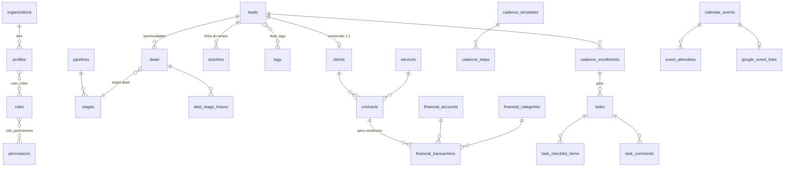

# HubSystem — Fase 0: descoberta e arquitetura

Status: **proposta aguardando aprovação** · Data: 30/10/2026

---

## 1. O que já existe

### Repositório local
`D:\MEU SERVIDOR\HubSystem - Sistema` está **vazio** (sem código, sem git). Ambiente: Node 24.14, npm 11.11, Git 2.53, Docker 29.9, Supabase CLI 2.122 (via `npx`), Vercel CLI disponível. Conta Vercel pessoal, sem times.

### Supabase — projeto `crm-leads` (`ykfmkelgbzobbsfyaxvb`, sa-east-1, Postgres 17)
Já existe um CRM em uso, com **dados reais**:

| Tabela | Linhas | Observação |
|---|---|---|
| `leads` | 252 | Empresas captadas do Google Maps (`place_id`, nota, avaliações, lat/lng, `maps_url`, redes sociais, DDD/região, `score`, `tags text[]`) |
| `deals` | 252 | Oportunidade por funil (lead × pipeline × etapa, valor, cobrança, posição, motivo de perda) |
| `pipelines` / `stages` | 2 / 16 | "Venda de Site" (10 etapas) e "Tráfego Pago" (6 etapas), com `kind` open/won/lost |
| `activities` | 280 | Linha do tempo (nota, WhatsApp, ligação, e-mail, reunião, mudança de etapa, importação) |
| `message_templates` | 13 | Mensagens de WhatsApp por etapa |
| `imports` / `niches` | 3 / 3 | Importação CSV com filtro por nicho e **desfazer importação** |
| `services` | 6 | Site institucional, Landing page, GMN, Manutenção, Google Ads, Meta Ads |
| `tasks`, `lost_reasons`, `client_services` | 1 / 8 / 0 | |

Funções existentes: `import_leads`, `undo_import`, `compute_lead_score`, `csv_to_jsonb`, `region_for_ddd`, triggers de etapa/atualização. 5 migrations aplicadas. Nenhum bucket de Storage. **1 usuário** no Auth.

Há também o projeto `mae-cheirosa-entregaveis`, sem relação com este sistema — não será tocado.

**Decisão:** o HubSystem usará um **projeto Supabase novo**. O `crm-leads` fica intacto (nada será alterado nele); dele aproveito apenas as ideias de modelagem descritas abaixo.

### Planilhas de leads (`csv leads/`)
| Arquivo | Linhas |
|---|---|
| `Nicho-Esquadrias-de-Aluminio.csv` | 83 |
| `Nicho-Marmoraria.csv` | 65 |
| `Nicho-Vidracaria.csv` | 109 |
| **Total** | **257** registros (≈ 254 empresas únicas) |

Formato exportado do Google Maps: UTF-8 com BOM, separador `;`, colunas `Empresa; Categoria; Telefone; Tipo de telefone; WhatsApp; Link WhatsApp; E-mail; Site; Instagram; Facebook; LinkedIn; Endereço; Bairro; Cidade; UF; CEP; Nota; Avaliações; Google Maps; Status; Anotações`.

Análise feita: 257 registros, todos com telefone e todos com `place_id` extraível do link do Maps (`!19sChIJ…`, junto com latitude/longitude). **3 duplicados exatos** entre arquivos (mesmo `place_id`) e **5 telefones repetidos** (inclui 2 empresas diferentes com o mesmo número — provável filial). Nenhum tem e-mail nem site, todos com status "Novo". O segmento vem do nome do arquivo (Esquadrias de Alumínio, Marmoraria, Vidraçaria).

Essas planilhas serão a **carga inicial pelo próprio assistente de importação** da Fase 2 — servem de teste real de ponta a ponta (mapeamento salvo para esse formato, deduplicação por `place_id` e telefone, relatório final).

### Ideias do schema `crm-leads` que serão reaproveitadas
**Bom e vale preservar:** separação `leads` (a empresa) × `deals` (a oportunidade em cada funil) — é exatamente o modelo certo para vender site e tráfego para o mesmo cliente; múltiplos funis; `kind` de etapa; posição fracionária para ordenação no Kanban; desfazer importação; templates por etapa.

**Não repetir no projeto novo:**
- **Risco de segurança alto no `crm-leads`:** todas as tabelas têm a política `authenticated full access` com `USING (true)`. Qualquer conta que consiga se cadastrar no Auth lê e apaga tudo. Se esse projeto continuar no ar, recomendo desligar o cadastro público nele (Auth → Sign In / Providers) — não farei isso sem sua autorização.
- Não há perfis, papéis, permissões nem auditoria.
- `tasks.lead_id` é obrigatório (impede tarefas avulsas); `tags` é `text[]` (sem cor, sem gestão central).
- Valores em `numeric` sem padrão de centavos; telefone sem coluna E.164.
- Não há clientes, contratos, agenda, finanças.

---

## 2. Decisões tomadas

1. **Projeto Supabase novo** (região sa-east-1, Postgres 17). O `crm-leads` não é alterado.
2. **Leads iniciais** vêm das planilhas em `csv leads/`, importadas pelo assistente da Fase 2.
3. **Uma empresa, pronta para crescer:** tabela `organizations` e `organization_id` em todas as tabelas de negócio, com uma única organização no MVP. Virar multiempresa depois exige só telas de cadastro e convite por organização, sem migrar dados.
4. **Financeiro pessoal visível ao dono e ao administrador.** Gestor, financeiro e demais papéis não veem. Toda consulta do administrador a lançamentos pessoais de outra pessoa fica registrada na auditoria (feita por RPC dedicada, não por leitura direta da tabela), e o dono vê esse registro.

Decisões menores já assumidas estão marcadas como **Suposição** ao longo do texto.

**Pendente antes da Fase 1:** o plano gratuito do Supabase permite 2 projetos ativos por organização e sua conta já tem 2 (`crm-leads` e `mae-cheirosa-entregaveis`). Para criar o projeto novo é preciso **pausar um deles** ou usar um plano pago. Vou confirmar o custo com você antes de criar.

---

## 3. Arquitetura

### Princípio central
**A regra de negócio e a autorização moram no banco** (constraints, triggers, funções RPC e RLS) e em um pacote TypeScript puro de domínio (schemas Zod, cálculos, formatação). O Next.js é uma camada de apresentação. Assim, um app nativo futuro (Expo/React Native) usa o mesmo Supabase, as mesmas RPCs e as mesmas políticas, sem reescrever regra nenhuma.

```
┌──────────── Navegador / PWA ────────────┐      ┌─── App nativo (futuro) ───┐
│ React Client Components                  │      │ Expo + supabase-js         │
│ TanStack Query · RHF + Zod · dnd-kit     │      │ mesmo src/domain           │
└───────────────┬──────────────────────────┘      └────────────┬──────────────┘
                │ Server Actions / Route Handlers                │
┌───────────────▼──────────────── Vercel ─┐                     │
│ Next.js App Router (RSC)                 │                     │
│ · sessão via @supabase/ssr (cookies)     │                     │
│ · validação Zod no servidor              │                     │
│ · OAuth Google, webhooks, cron           │                     │
│ · service role SOMENTE aqui              │                     │
└───────────────┬──────────────────────────┘                     │
                │ JWT do usuário (RLS aplicada)                   │
┌───────────────▼─────────────────────────────────────────────────▼──┐
│ Supabase: Postgres 17 · RLS · RPCs · triggers de auditoria          │
│ Auth (convite, sem cadastro público) · Storage privado · Vault       │
└─────────────────────────────────────────────────────────────────────┘
```

### Stack (versões estáveis confirmadas no momento do scaffold)

| Necessidade | Escolha | Por quê |
|---|---|---|
| Framework | Next.js (App Router, última estável) + React 19, TypeScript `strict` | Pedido; RSC reduz JS no cliente |
| Supabase | `@supabase/supabase-js` + `@supabase/ssr` | Sessão em cookie, compatível com RSC e middleware |
| UI | Tailwind CSS v4 + shadcn/ui (Radix) | Componentes acessíveis, código nosso, sem lock-in |
| Formulários | React Hook Form + Zod (`@hookform/resolvers`) | Mesmo schema no cliente e no servidor |
| Dados no cliente | TanStack Query | Só onde há interatividade (Kanban, filtros, otimista com rollback) |
| Tabelas | TanStack Table + TanStack Virtual | Headless, paginação/ordenação no servidor, virtualização |
| Drag and drop | dnd-kit (core + sortable) | Suporte a teclado e leitor de tela |
| Datas | date-fns + `@date-fns/tz` | Fuso `America/Sao_Paulo`, locale pt-BR |
| Telefone | libphonenumber-js | Normalização E.164 |
| Planilhas | Papa Parse (CSV) + SheetJS CE (XLSX, pacote oficial do CDN da SheetJS) | Parse no navegador; o arquivo não precisa subir ao servidor |
| Gráficos | Recharts | Maduro, SVG, permite tabela alternativa |
| Toasts | Sonner | Suporta ação "Desfazer" |
| PWA | Serwist | Sucessor mantido do next-pwa |
| Google | `googleapis` (somente servidor) | API oficial, OAuth 2.0 |
| Testes | Vitest + Testing Library · Playwright · pgTAP (`supabase test db`) | Unitário, E2E e RLS |
| Qualidade | ESLint (config Next) + Prettier + `tsc --noEmit` | |

**Suposição:** gerenciador `npm` (já instalado). Sem ORM — tipos gerados pelo Supabase CLI (`supabase gen types`), evitando duas fontes de verdade.

### Estrutura de pastas
```
src/
  app/
    (auth)/login, recuperar-senha, redefinir-senha, convite
    (app)/inicio, crm/…, clientes/…, contratos/…, agenda, tarefas/…,
          financeiro/[contexto]/…, dashboards/…, configuracoes/…
    api/google/oauth, api/google/webhook, api/cron/…
  domain/            # TS puro, sem React/Next: schemas Zod, regras, money, datas, telefone
    crm/ tasks/ finance/ contracts/ permissions/ shared/
  features/          # UI + server actions por módulo (crm/, tasks/, finance/…)
  components/ui/     # shadcn
  components/app/    # shell, page-header, data-table, empty-state, error-state…
  lib/supabase/      # server.ts, client.ts, middleware.ts, admin.ts (server-only)
supabase/
  migrations/  tests/ (pgTAP)  seed.sql
tests/e2e/           # Playwright
docs/adr/            # decisões arquiteturais
```

### Padrões transversais
- **Leitura:** Server Components consultam com o JWT do usuário; RLS filtra.
- **Escrita:** Server Action → valida com Zod → chama RPC/tabela com JWT do usuário → `revalidatePath`/invalidação. Erros retornam `{ ok: false, code, message, fieldErrors }` padronizado.
- **Service role:** só em `lib/supabase/admin.ts` com `import 'server-only'`, usado para convite de usuário, tokens do Google e cron.
- **Autorização em duas camadas:** checagem de permissão na action (UX e mensagem clara) **e** RLS (garantia). A interface esconder botão é só conveniência.
- **Erros e logs:** `error.tsx`/`not-found.tsx` por segmento; logger estruturado que remove e-mail, telefone e tokens; Vercel Observability + Sentry opcional na Fase 7.

---

## 4. Modelo de dados

### Convenções
- PK `uuid` (`gen_random_uuid()`); `organization_id` em toda tabela de negócio (se aprovado na decisão 3).
- `created_at`, `updated_at` (trigger), `created_by`, `updated_by` (default `auth.uid()`).
- Instantes em `timestamptz` (UTC no banco, exibidos em `America/Sao_Paulo`); datas civis (competência, vencimento) em `date`.
- Dinheiro em `bigint` **centavos** (`amount_cents`), com `check (amount_cents >= 0)` e o sinal dado pelo tipo do lançamento.
- Telefone: `phone_e164 text check (phone_e164 ~ '^\+[1-9]\d{7,14}$')`; o texto original é preservado.
- **Soft delete** (`deleted_at`, `deleted_by`) em leads, clientes, contratos, tarefas, eventos e lançamentos: some das listas, vai para a Lixeira por 30 dias, pode ser restaurado. Exclusão definitiva só por RPC administrativa (LGPD).
- Enums do Postgres para estados estáveis; tabelas de configuração para o que o usuário personaliza (etapas, categorias, etiquetas).

### Diagrama de relacionamentos (núcleo)


### Tabelas por domínio

#### Identidade e acesso
| Tabela | Colunas principais | Notas |
|---|---|---|
| `organizations` | id, name, settings jsonb (fuso, moeda, mensagem padrão do WhatsApp) | |
| `profiles` | id = `auth.users.id`, organization_id, full_name, avatar_path, phone_e164, is_active, last_seen_at, preferences jsonb (tema, sidebar, filtros salvos) | Criado por trigger no convite |
| `roles` | id, key (`admin`, `gestor`, `vendedor`, `financeiro`, `colaborador`), name, is_system | Papéis do sistema não podem ser apagados |
| `permissions` | key (`crm.leads.read`…), module, description | Catálogo fixo via migration |
| `role_permissions` | role_id, permission_key, scope (`own` / `team` / `all`) | |
| `user_roles` | user_id, role_id | |
| `user_permission_overrides` | user_id, permission_key, effect (`grant`/`deny`), scope | O admin libera/bloqueia por usuário |
| `teams`, `team_members` | | Habilita o escopo `team` |
| `audit_logs` | id bigint, at, actor_id, action, entity_type, entity_id, changes jsonb (só campos alterados), ip, user_agent | Somente inserção; nem admin edita ou apaga |

#### CRM
| Tabela | Colunas principais |
|---|---|
| `leads` | A **empresa** prospectada. name, company_name, phone_raw, phone_e164, phone_type, whatsapp_e164, email, website, instagram, facebook, linkedin, address, neighborhood, city, state (UF, check), zip, lat, lng, `place_id` unique, gmb_url, gmb_rating, gmb_reviews_count, segment_id, source, owner_id (responsável), notes, last_contact_at, next_contact_at, status (`ativo`/`cliente`/`descartado`), import_id, deleted_at |
| `segments` | name, slug (Esquadrias de Alumínio, Marmoraria, Vidraçaria…) |
| `deals` | A **oportunidade** de um lead em um funil. lead_id, pipeline_id, stage_id, owner_id, amount_cents, billing, position (float, ordenação no Kanban), expected_close_date, lost_reason_id, lost_note, won_at, lost_at, stage_changed_at |
| `deal_services` | Serviços de interesse da oportunidade |
| `pipelines`, `stages` | Funis configuráveis; etapa com position, color, `kind` (`open`/`won`/`lost`), `sla_days` para detectar atraso |
| `deal_stage_history` | deal_id, from_stage_id, to_stage_id, moved_by, moved_at. Gravada por trigger; base dos dashboards de conversão |
| `activities` | Linha do tempo/interações (o `lead_interactions` pedido): type (nota, whatsapp, ligação, e-mail, reunião, mudança de etapa, importação, sistema), content, metadata, lead_id, deal_id?, client_id?, contract_id? |
| `tags`, `lead_tags` | Etiquetas com nome único e cor |
| `lost_reasons` | Motivos de perda configuráveis |
| `message_templates` | Mensagens de WhatsApp por funil/etapa, com variáveis (`{nome}`, `{empresa}`, `{responsavel}`) |
| `imports`, `import_mappings` | Histórico de importações (totais, rejeitados, desfazer) e mapeamentos de colunas salvos por formato de arquivo |

Seed: funil **"Venda de Site"** com as 11 etapas pedidas (Lead importado … Cliente fechado = `won`, Perdido = `lost`) e funil **"Tráfego Pago"** (Oferecer tráfego, Apresentado, Proposta enviada, Negociação, Contratou, Não contratou), os 6 serviços e os motivos de perda usados no `crm-leads`. *Suposição: o segundo funil é útil; pode ser desativado.*

#### Cadências
| Tabela | Colunas |
|---|---|
| `cadence_templates` | name, description, pipeline_id?, is_active |
| `cadence_steps` | template_id, position, day_offset, time_of_day, channel (`whatsapp`/`ligacao`/`email`/`reuniao`), instruction, message_template |
| `cadence_enrollments` | lead_id, deal_id?, template_id, owner_id, started_at, status (`ativa`/`pausada`/`concluida`/`cancelada`) |

Ao inscrever um lead, uma RPC gera **tarefas** (uma por etapa) com `cadence_step_id`. Decisão: **não existe uma tabela separada de "atividades agendadas"** — tudo que precisa ser feito é uma `task`. Com isso a mesma ação aparece no CRM, na agenda e na lista de tarefas sem sincronização entre tabelas. "Atrasada" é **calculada** (`due_at < now()` e não concluída), nunca gravada, para não ficar inconsistente.

#### Clientes, serviços e contratos
| Tabela | Colunas |
|---|---|
| `clients` | id, **lead_id unique** (FK), legal_name, document (CPF/CNPJ validado), billing_email, billing_phone_e164, converted_at, converted_by, status |
| `services` | name, kind (`site`, `manutencao`, `meta_ads`, `google_ads`, `outro`), is_recurring, default_price_cents, is_active |
| `contracts` | client_id, service_id, deal_id?, owner_id, description, amount_cents, payment_method_id, start_date, end_date, due_day, recurrence (`unica`/`mensal`/`trimestral`/`anual`), status (`rascunho`/`ativo`/`pausado`/`encerrado`/`cancelado`), notes |

**Conversão:** a RPC `convert_lead(deal_id, client_data)` em uma transação: marca o negócio como ganho, cria `clients` ligado ao mesmo `lead_id`, cria o contrato, registra auditoria e atividade. O cliente **é** o lead convertido — contatos, etiquetas e linha do tempo continuam no `lead_id`, sem duplicar dados.

#### Tarefas
| Tabela | Colunas |
|---|---|
| `tasks` | title, description, owner_id, priority (`baixa`/`media`/`alta`/`urgente`), start_date, due_at, has_time, status (`a_fazer`/`em_andamento`/`concluida`/`cancelada`), category, position, lead_id?, deal_id?, client_id?, contract_id?, cadence_step_id?, channel?, completed_at |
| `task_checklist_items` | task_id, title, position, done_at, done_by |
| `task_comments` | task_id, author_id, body |
| `task_tags` | task_id, tag_id |

Todos os vínculos são opcionais (tarefas avulsas são permitidas).

#### Agenda e Google Calendar
| Tabela | Colunas |
|---|---|
| `calendar_events` | title, description, starts_at, ends_at, all_day, kind (`reuniao`/`compromisso`/`bloqueio`), location, meet_url, owner_id, lead_id?, client_id?, contract_id?, reminder_minutes[] |
| `event_attendees` | event_id, user_id? / email, response |
| `google_calendar_connections` | user_id (unique), google_email, calendar_id, scopes, **vault_secret_id** (refresh token no Supabase Vault), access_expires_at, sync_token, channel_id, channel_expires_at, status | Sem política para `authenticated`; só o servidor (service role) lê |
| `google_event_links` | event_id, connection_id, google_event_id, etag, last_synced_at, unique(connection_id, google_event_id) |

A agenda exibe a união de `calendar_events` e `tasks` com horário (view `agenda_items`). Conflito = sobreposição de intervalos do mesmo usuário, calculada na consulta.

#### Financeiro
| Tabela | Colunas |
|---|---|
| `financial_accounts` | scope (`pessoal`/`empresa`), owner_user_id (obrigatório se pessoal), name, type (corrente, poupança, cartão, dinheiro), opening_balance_cents |
| `financial_categories` | scope, owner_user_id?, name, kind (`receita`/`despesa`), parent_id |
| `cost_centers` | name (somente empresa) |
| `payment_methods` | name (Pix, boleto, cartão, transferência, dinheiro) |
| `financial_recurrences` | regra (frequência, dia, fim), modelo do lançamento |
| `financial_transactions` | scope, owner_user_id?, kind (`receita`/`despesa`/`transferencia`), description, amount_cents, category_id, cost_center_id?, account_id, payment_method_id?, competence_date, due_date, paid_at, paid_amount_cents, status (`previsto`/`pago`/`cancelado`), installment_group_id, installment_number/total, recurrence_id?, client_id?, contract_id?, reconciled_at, reconciled_by, notes |

**Separação pessoal × empresarial:** a coluna `scope` existe nas contas, categorias e lançamentos, com `check (scope = 'empresa' or owner_user_id is not null)` e trigger que impede vincular um lançamento pessoal a conta/categoria empresarial (e vice-versa). Permissões distintas (`finance.company.*` e `finance.personal.*`), rotas distintas (`/financeiro/empresa`, `/financeiro/pessoal`), e relatórios sempre filtrados por um único contexto.

"Vencido" e "a vencer" são **derivados** de `due_date` e `status`. Recorrências geram ocorrências até um horizonte de 12 meses (RPC + cron diário), para que fluxo de caixa e previsão sejam simples consultas. Parcelamento gera N lançamentos com o mesmo `installment_group_id`, dividindo os centavos sem perder arredondamento.

#### Anexos
`attachments`: entity_type, entity_id, storage_path, file_name, mime_type, size_bytes, uploaded_by. Bucket **privado** `attachments`, caminho `{org}/{entity_type}/{entity_id}/{uuid}`. Limite de 15 MB e lista de tipos (PDF, imagens, DOCX, XLSX) **no bucket e na action**. Políticas do Storage reutilizam a mesma função de acesso da entidade-mãe; download por URL assinada de curta duração.

### Índices principais
- `leads`: `(organization_id, owner_id)`, `(next_contact_at)` parcial onde não excluído, `phone_e164`, `place_id` unique, GIN `pg_trgm` em `name`, `company_name`, `city` para busca.
- `deals`: `(pipeline_id, stage_id, position)`, `(owner_id)`.
- `tasks`: `(owner_id, status, due_at)`, FKs de vínculo.
- `calendar_events`: `(owner_id, starts_at)` e índice GiST em `tstzrange(starts_at, ends_at)` para conflitos.
- `financial_transactions`: `(scope, owner_user_id, due_date)`, `(account_id, paid_at)`, `(competence_date)`, `(contract_id)`.
- Toda FK com índice; `audit_logs (entity_type, entity_id, at desc)`.

### RLS
- RLS ligada em **todas** as tabelas do `public`, sem nenhuma política `USING (true)`.
- Funções `SECURITY DEFINER` em schema `private` (sem acesso pela API), `stable`, com `search_path` fixo:
  - `private.has_perm(key text) → boolean`
  - `private.perm_scope(key text) → 'own'|'team'|'all'|null`
  - `private.can_access_lead(lead_id uuid)`, `private.org_id()`
- Padrão de política (leads, exemplo):
  ```sql
  create policy leads_select on leads for select to authenticated using (
    organization_id = (select private.org_id())
    and deleted_at is null
    and case (select private.perm_scope('crm.leads.read'))
          when 'all'  then true
          when 'team' then private.same_team(owner_id)
          when 'own'  then owner_id = (select auth.uid())
          else false end
  );
  ```
  O `(select …)` faz o Postgres avaliar a função uma vez por consulta, não por linha.
- Financeiro pessoal: a política da tabela permite apenas `scope = 'pessoal' and owner_user_id = auth.uid()`. O administrador consulta o financeiro pessoal de outra pessoa somente pela RPC `admin_read_personal_finance(user_id, período)`, que confere o papel, grava auditoria e devolve os dados — assim o acesso nunca acontece "sem rastro".
- Tokens do Google: tabela sem política para `authenticated` (nega tudo); refresh token só no Vault.
- Auth: **cadastro público desligado**; entrada apenas por convite do administrador.
- Testes pgTAP cobrem cada papel × tabela × operação (vendedor A não lê lead do vendedor B, colaborador não lê financeiro etc.).

### Auditoria
Trigger genérico `audit.log_change()` nas tabelas sensíveis grava somente os campos alterados. Ações auditadas: mudanças em `user_roles`/overrides/`profiles.is_active`; exclusões (soft e definitivas); troca de `owner_id`; alteração de `amount_cents`, `paid_at`, `status` financeiro; conversão de lead; qualquer alteração em `contracts`. Valores de telefone/e-mail não entram no log, apenas o nome do campo alterado.

---

## 5. Sistema de permissões

Permissão = `módulo.recurso.ação`, com escopo `own` / `team` / `all`.

| Módulo | Ações |
|---|---|
| `crm.leads` | read, create, update, delete, import, export, assign |
| `crm.pipeline` | move, configure |
| `crm.cadences` | read, manage |
| `clients` / `contracts` | read, create, update, delete |
| `tasks` | read, create, update, delete |
| `calendar` | read, manage |
| `finance.company` | read, create, update, delete, reconcile, reports |
| `finance.personal` | read, manage (sempre `own`) |
| `dashboards` | commercial, financial |
| `admin` | users, roles, settings, audit, data_export |

| Papel padrão | Resumo |
|---|---|
| **Administrador** | Tudo, escopo `all` |
| **Gestor** | CRM, clientes, contratos, tarefas e agenda com `all`; dashboards; sem finanças da empresa (liberável) e sem admin |
| **Vendedor** | CRM, tarefas e agenda com `own`; vê clientes; cria contratos próprios; dashboard comercial próprio |
| **Financeiro** | Finanças da empresa `all`; lê clientes e contratos; dashboard financeiro |
| **Colaborador** | Tarefas e agenda `own`; leitura de leads atribuídos |

Todos têm `finance.personal` para o próprio uso (desligável). O administrador tem ainda `finance.personal.admin_read`, que permite consultar (com auditoria) o financeiro pessoal dos demais. O administrador ajusta papéis e libera/bloqueia permissões por usuário em uma matriz módulo × ação.

---

## 6. Mapa de telas

```
Início (Meu dia)
CRM
 ├ Leads ............ tabela | lista | funil (Kanban) — mesmos filtros nas três
 ├ Lead ............. painel lateral (desktop) / tela cheia (celular); URL própria
 ├ Importar ......... assistente em 5 passos
 └ Cadências ........ modelos e etapas
Clientes ............ lista → detalhe (contratos, financeiro, histórico)
Contratos ........... tabela → detalhe
Agenda .............. dia | semana | mês
Tarefas ............. Meu dia | lista | Kanban | calendário
Financeiro
 ├ Empresa .......... visão geral, lançamentos, a pagar, a receber, fluxo de caixa, conciliação
 └ Pessoal .......... mesmas telas, contexto separado
Dashboards .......... comercial | financeiro
Configurações ....... perfil, usuários, papéis e permissões, funis e etapas, serviços,
                      etiquetas, mensagens, categorias e contas, integrações (Google),
                      auditoria, lixeira, dados e privacidade (exportar/excluir)
Acesso .............. login, recuperar senha, redefinir senha, aceitar convite
```

O componente certo para cada informação: **tabela** para leads, contratos e lançamentos (muitos registros, comparação de colunas); **Kanban** para o funil e tarefas por status; **lista agrupada por horário** para Meu dia; **grade de calendário** para agenda; **painel lateral** para detalhes frequentes sem perder o contexto da lista; **gráficos** apenas nos dashboards e no fluxo de caixa.

---

## 7. Fluxos principais

**Importação de leads**
1. Enviar CSV/XLSX (lido no navegador, até 10 mil linhas).
2. Pré-visualizar as 20 primeiras linhas.
3. Mapear colunas (sugestão automática por nome; mapeamento salvo para a próxima vez).
4. Validar: telefone → E.164, e-mail, UF; duplicados por `place_id`, telefone ou e-mail, **dentro do arquivo e contra o banco** (RPC de verificação em lote). Para cada duplicado: ignorar, atualizar ou criar mesmo assim.
5. Resumo (válidos, inválidos com motivo, duplicados) → confirmar → RPC transacional em lotes → relatório final com opção de **desfazer importação** e baixar CSV dos rejeitados.

**Movimentar no funil**
Arrastar (ou, pelo teclado, selecionar o card e usar "Mover para…") → atualização otimista → RPC `move_deal(deal_id, stage_id, position)` valida permissão e grava histórico → em erro, o card volta e aparece aviso. Mover para "Perdido" abre o motivo de perda. Mover para "Cliente fechado" oferece a conversão.

**Converter lead em cliente**
No lead ou ao fechar o negócio: confirmar dados (razão social, CPF/CNPJ, contato de cobrança) → escolher serviço e valores → `convert_lead` cria cliente + contrato + recebíveis previstos (opcional) → o lead passa a mostrar a aba "Cliente".

**Próximo contato / cadência**
No lead: "Agendar próximo contato" (atalho de 1, 3, 7 dias ou data) cria tarefa e atualiza `next_contact_at`. "Iniciar cadência" gera as tarefas do modelo. Cada tarefa de WhatsApp tem o botão "Abrir conversa" (`wa.me` com a mensagem preenchida) e, ao voltar, "Registrar contato".

**Concluir tarefa**
Checkbox na própria linha → risca na hora, toast "Tarefa concluída · Desfazer" por 5 s → persistência com rollback se falhar.

**Lançamento financeiro**
Escolher contexto (o seletor fica no topo e muda a cor de identificação da área) → receita/despesa → valor, vencimento, categoria, conta → opções avançadas recolhidas: parcelamento, recorrência, centro de custo, vínculo com cliente/contrato, anexo. "Marcar como pago" pergunta data e valor efetivamente pago.

**Google Calendar**
Configurações → Integrações → "Conectar Google Agenda" → OAuth no servidor (escopo `calendar.events`, `access_type=offline`) → refresh token no Vault → sincronização inicial (eventos de 30 dias atrás a 180 à frente) → depois incremental via `syncToken` + notificações push (webhook) + cron de segurança. Eventos criados aqui vão para o Google com `extendedProperties.private.hubsystemId`, o que impede duplicação no retorno. Conflito de edição: vence a alteração mais recente (`updated`/etag), com registro na linha do tempo. "Desconectar" revoga o token no Google e apaga o segredo.

---

## 8. Direção visual

**Assunto:** a mesa de trabalho de uma pequena agência que capta negócios locais no Google Maps, vende site e tráfego, e precisa saber todo dia *com quem falar agora*. O trabalho principal da interface é responder a essa pergunta e deixar a ação a um clique.

**Conceito: "caderno de campo".** Em vez do kit de cards com sombra, a interface é feita de superfícies planas, linhas de tabela bem espaçadas e uma única faixa de destaque: a **Próxima ação**. Em todo lead, cliente e na tela inicial, a próxima ação aparece como uma faixa à esquerda do conteúdo, com prazo e situação (em dia, hoje, atrasada) indicados por cor **e** ícone **e** texto. É o único elemento ousado; o resto é silencioso.

### Cores (claro / escuro)
| Token | Claro | Escuro | Uso |
|---|---|---|---|
| `--bg` | `#F5F6F3` | `#121614` | Fundo, um cinza levemente esverdeado, não creme |
| `--surface` | `#FFFFFF` | `#1A1F1C` | Tabelas, painéis |
| `--ink` | `#1C2420` | `#E6EAE7` | Texto |
| `--muted` | `#5B6660` | `#9AA59F` | Texto secundário (contraste ≥ 4,5:1 nos dois temas) |
| `--primary` | `#0E5E59` petróleo | `#4FB3A9` | Ação principal, seleção, foco |
| `--signal` | `#B5530A` cobre | `#F0A35E` | Somente a faixa de Próxima ação e "hoje" |
| Estados | sucesso `#1F7A4D`, atenção `#9A6700`, erro `#B42318`, info `#1D5FA8` | versões clareadas | Sempre acompanhados de ícone e rótulo |

Financeiro empresarial e pessoal ganham um marcador de contexto (barra lateral fina petróleo × ameixa `#6B3F7A`) para que nunca se confunda em qual contexto se está lançando.

### Tipografia
**IBM Plex Sans** em toda a interface: humanista, ótima em tamanhos pequenos, acentuação completa do português e **algarismos tabulares** (`font-variant-numeric: tabular-nums`) — essencial para colunas de valores em reais alinharem. Uma única família, hierarquia por peso e tamanho: 12 / 14 (corpo) / 16 / 20 / 24 / 32. Rótulos em caixa normal (sem caixa-alta espaçada).

### Layout
```
Desktop                                           Celular
┌────────┬──────────────────────────────────┐     ┌──────────────────────┐
│ Hub    │ CRM › Leads           [+ Novo lead]│     │ Leads          [⌕][+]│
│        │ ┌ filtros salvos ─────────────────┐│     │ ┌ chip filtros ──────┐│
│ Início │ │Etapa▾ Resp.▾ Cidade▾  ⌕ buscar  ││     │ └────────────────────┘│
│ CRM    │ └─────────────────────────────────┘│     │ ▌Ligar hoje 14h      │
│ Client.│  Nome        Etapa    Próx. ação   │     │  Padaria Sol · Campin│
│ Agenda │  Padaria Sol Análise ▌Hoje 14h     │     │ ▌Atrasada 2 dias     │
│ Tarefas│  Studio Ka   Proposta ▌Atrasada 2d │     │  Studio Ka · Santos  │
│ Financ.│  …                                 │     │                      │
│ Dashb. │                    ┌ painel lead ──┤     ├──────────────────────┤
│        │                    │ Próxima ação  │     │ Início CRM Agenda    │
│ ⚙  «   │                    │ Contato · Tl. │     │ Tarefas   Mais       │
└────────┴────────────────────┴───────────────┘     └──────────────────────┘
```
- Sidebar de 240 px recolhível para trilho de 64 px (estado salvo no perfil).
- Celular: barra inferior com 4 destinos + "Mais", botão "+" de criação rápida contextual, tabelas viram listas de 2 linhas, painéis viram tela cheia, alvos de toque ≥ 44 px.
- Cabeçalho de página: breadcrumbs, título, **uma** ação primária, ações secundárias em menu.
- Alinhamento à esquerda; valores monetários à direita.
- Raio: 6 px em controles, 10 px em painéis — hierarquia por raio, não um raio único.
- Movimento: apenas em resposta a ações (abrir painel, mover card, concluir tarefa), 150–200 ms, desligado com `prefers-reduced-motion`.

### Voz
Verbos diretos e específicos: "Importar leads", "Agendar próximo contato", "Marcar como pago". O toast repete o verbo do botão ("Lead importado"). Erros dizem o que aconteceu e como resolver, sem pedir desculpas. Estados vazios convidam a agir ("Nenhum lead ainda. Importe uma planilha do Google Maps ou cadastre o primeiro.").

---

## 9. Escopo do MVP

**Dentro do MVP (Fases 1–5):** acesso por convite com papéis e permissões; RLS em tudo; auditoria; CRM completo (tabela, lista, Kanban, importação, painel do lead, WhatsApp, etiquetas, histórico, próxima ação); cadências manuais; tarefas com checklist e Meu dia; agenda interna; conversão, clientes, contratos e anexos; financeiro empresarial e pessoal com contas, categorias, lançamentos, parcelas, recorrências, a pagar/receber e fluxo de caixa; PWA instalável.

**Depois do MVP (Fases 6–7):** Google Calendar bidirecional; dashboards comercial e financeiro completos com previsão; conciliação por importação de extrato (OFX); notificações push; exportação LGPD completa.

**Fora do escopo:** envio automático de WhatsApp (só com a API oficial da Meta, em fase futura), emissão de nota fiscal, cobrança/boletos integrados.

---

## 10. Plano por fases

| Fase | Entregas | Critério de saída |
|---|---|---|
| **1 Fundação** | Git + scaffold Next + Tailwind + shadcn; criação do projeto Supabase novo e Supabase local (Docker); clientes Supabase SSR + middleware; migrations de organização, perfis, papéis, permissões, overrides, auditoria; cadastro público desligado; login, logout, recuperar senha, convite; shell (sidebar, barra inferior, cabeçalho, temas); componentes base (DataTable, EmptyState, ErrorState, ConfirmDialog, toasts com desfazer); telas de usuários e permissões; CI de lint/typecheck/test/build | Usuário de cada papel só acessa o permitido (pgTAP + E2E) |
| **2 CRM** | Migrations de leads/deals/funis/etiquetas/histórico; tabela, lista e Kanban com filtros persistentes; painel do lead; importação em 5 passos; WhatsApp; motivo de perda; próxima ação; cadências básicas; **carga das 3 planilhas** | Planilhas importadas com duplicados identificados e relatório; importação e Kanban testados E2E |
| **3 Tarefas e agenda** | Tarefas, checklists, comentários, Meu dia, Kanban, calendário interno dia/semana/mês, conflitos, vínculos | Concluir tarefa com desfazer; evento ligado a lead |
| **4 Clientes e contratos** | Conversão transacional, clientes, contratos, serviços, anexos (Storage), histórico | Conversão preserva linha do tempo; anexo inacessível a quem não tem permissão |
| **5 Financeiro** | Contas, categorias, centros de custo, lançamentos, parcelas, recorrências, a pagar/receber, fluxo de caixa, conciliação manual, recebíveis de contratos | Isolamento pessoal × empresa provado em pgTAP; somas em centavos testadas |
| **6 Integrações e dashboards** | Google Calendar (OAuth, Vault, sync incremental, webhook, revogação); dashboards comercial e financeiro | Sem duplicidades em sincronização de ida e volta |
| **7 Produção** | Auditoria de acessibilidade, desempenho, segurança (Supabase advisors), PWA, observabilidade, deploy Vercel, documentação | Lighthouse/axe sem falhas críticas; advisors sem alertas |

Cada fase termina com: resumo, arquivos alterados, migrations, saída de lint/typecheck/testes/build, pendências reais e próxima etapa.

---

## 11. Critérios de aceite (gerais)

Uma funcionalidade só está pronta quando: persiste no Supabase; valida com Zod no cliente e no servidor; respeita permissão na action **e** na RLS (com teste); tem estados de carregamento, vazio, erro com "Tentar novamente", sucesso e sem permissão; funciona em 360 px e em desktop; é operável só pelo teclado com foco visível; passa em typecheck, lint, testes e build.

---

## 12. Riscos e dependências

| Risco | Mitigação |
|---|---|
| Limite de 2 projetos gratuitos no Supabase | Pausar um projeto existente ou assinar plano pago — decisão sua antes da Fase 1 |
| `crm-leads` segue com políticas abertas | Fora do escopo do HubSystem; recomendo desligar o cadastro público nele |
| Migrations aplicadas em produção | Toda migration roda e passa nos testes pgTAP no Supabase local antes de ir ao projeto remoto |
| Google OAuth exige app verificado para escopos sensíveis | Em modo "teste" funciona para até 100 usuários cadastrados no console; verificação só se abrir para terceiros |
| Webhook do Google requer URL pública HTTPS | Disponível no deploy da Vercel; localmente, sincronização manual |
| Cron na Vercel (plano Hobby limita frequência) | Recorrências e renovações rodam 1×/dia — suficiente; alternativa: `pg_cron` no Supabase |
| Variáveis necessárias | `NEXT_PUBLIC_SUPABASE_URL`, `NEXT_PUBLIC_SUPABASE_PUBLISHABLE_KEY`, `SUPABASE_SECRET_KEY` (só servidor), `GOOGLE_CLIENT_ID/SECRET`, `CRON_SECRET` |

---

## 13. Decisões arquiteturais (ADRs a registrar em `docs/adr/`)

1. Regra de negócio e autorização no banco (RLS + RPC) para reaproveitar no app nativo.
2. Projeto Supabase novo; `leads` = empresa, `deals` = oportunidade, `clients` 1:1 com lead.
9. Organização única com `organization_id` em todas as tabelas (pronto para multiempresa).
10. Financeiro pessoal: dono vê direto; administrador só via RPC auditada.
3. Tarefa como unidade única de "coisa a fazer" (cadência, agenda e tarefas leem a mesma tabela).
4. Estados derivados (atrasado, vencido) calculados, não gravados.
5. Dinheiro em centavos `bigint`; datas civis em `date`, instantes em `timestamptz`.
6. Permissões `módulo.recurso.ação` com escopo, papéis + exceções por usuário.
7. Tokens externos no Supabase Vault, acessados apenas pelo servidor.
8. Sem ORM; tipos gerados do banco.
