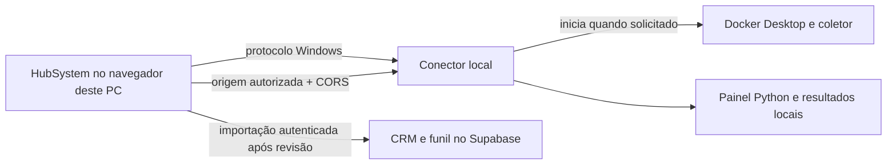

# Prospectador local conectado ao HubSystem

## Uso

O Prospectador aparece só para a conta dona da plataforma (`private.workspace_creators`), porque o conector roda no computador dela. Outras contas continuam usando a importação de planilhas.

1. Abra **Comercial → Prospectador**. Com o conector ligado, a própria tela abre o Docker Desktop, sobe somente `google-maps-scraper` e inicia o painel Python, mostrando cada etapa.
2. Se o conector estiver desligado (por exemplo, depois de reiniciar o Windows), clique em **Ligar prospectador** e aceite a abertura do aplicativo. Na primeira vez no domínio publicado, permita também o acesso à rede local. Instalar com `-AutoStart` dispensa esse clique.
3. Informe o que procurar, UF, cidade e abrangência. A cidade é conferida com a lista de municípios do estado. As buscas usam a fila original do prospectador, uma por vez, e podem ser canceladas ou repetidas na própria lista. **Painel completo** abre os demais recursos locais.
4. Na busca concluída, clique em **Revisar e importar**. Escolha o funil e o tratamento de duplicados, revise e confirme. Os resultados vão diretamente do computador ao assistente de importação, sem baixar ou selecionar arquivos.
5. Use **Parar coletor** quando terminar. O botão fica indisponível enquanto há buscas na fila. O volume de resultados é preservado; outros containers e o Docker Desktop continuam funcionando. O painel e o conector ficam disponíveis para consultar resultados e ligar novamente. Depois de parar, o coletor só volta sozinho ao recarregar ou abrir a página de novo.

No celular, a tela explica que as buscas rodam no computador e leva aos leads. Os leads importados ficam no HubSystem e podem ser trabalhados mesmo com o computador desligado. Novas buscas e leitura dos resultados locais exigem este computador ligado e o navegador nele. Fechar a aba não cancela buscas. A importação não prossegue com a aba fechada.

## Estrutura encontrada

- HubSystem: Next.js na Vercel, autenticação e CRM no Supabase. As importações passam pela Server Action `importLeads` e pela RPC `import_leads`, com permissões, RLS, validação, deduplicação e histórico.
- Projeto local: `D:\MEU SERVIDOR\PROSPCTADOR DE SITES\google-maps-claude-kit-sales-main`.
- Motor: `gosom/google-maps-scraper:v1.18.1`, serviço Compose `google-maps-scraper`, container `gmaps-scraper`, porta local 8080 por padrão.
- Nesta máquina, a porta 8080 estava ocupada/indisponível para bind; o `.env` do prospectador e o conector foram configurados para **18080**, validada como disponível.
- Painel: `painel/server.py`, biblioteca padrão do Python, porta 8090. Gerencia fila, buscas, normalização brasileira, contatos e enriquecimento de redes sociais. Persiste em `painel/dados/`.
- Conector: `scripts/prospectador/bridge.py`, porta **127.0.0.1:8091**. Atua como adaptador das APIs do painel e controla o serviço Compose.



O servidor na Vercel não tenta acessar `localhost`: a conexão local parte do navegador. Não são necessários túnel, abertura de porta no roteador ou chave administrativa do Supabase no computador.

## Instalação e atualização

Requisitos: Windows, Docker Desktop com engine Linux funcionando e Python 3.10+ com `pythonw.exe`.

Execute na raiz do HubSystem:

```powershell
powershell -NoProfile -ExecutionPolicy Bypass -File scripts/prospectador/install.ps1
```

Para outro caminho ou domínio:

```powershell
powershell -NoProfile -ExecutionPolicy Bypass -File scripts/prospectador/install.ps1 `
  -ProjectPath 'D:\caminho\google-maps-claude-kit-sales-main' `
  -HubOrigin 'https://seu-hub.example' `
  -PythonPath 'C:\caminho\python.exe'
```

O instalador copia o conector e o override Compose para `%LOCALAPPDATA%\HubSystem\Prospectador`, grava a configuração local, registra `hubsystem-prospectador://` em `HKCU\Software\Classes` e deixa o conector ligado. Não exige administrador. O comando registrado é fixo: a URL recebida nunca vira argumento de shell.

Para o conector iniciar com o Windows, sem o clique em **Ligar prospectador**, inclua `-AutoStart`. Isso grava o valor `HubSystemProspectador` em `HKCU\Software\Microsoft\Windows\CurrentVersion\Run`. Ele só escuta em `127.0.0.1` e consome pouca memória; o Docker continua ligando apenas ao abrir o Prospectador:

```powershell
powershell -NoProfile -ExecutionPolicy Bypass -File scripts/prospectador/install.ps1 -AutoStart
```

Reexecute o instalador após atualizar o conector: ele encerra somente o conector instalado e o liga de novo. O código da tela precisa ser publicado no deploy do HubSystem para aparecer na versão hospedada; a instalação local não publica o site.

Para retirar o conector, o protocolo e a inicialização com o Windows:

```powershell
powershell -NoProfile -ExecutionPolicy Bypass -File scripts/prospectador/install.ps1 -Uninstall
```

Essa remoção preserva dados e configuração. Nenhuma migration é necessária para esta integração.

## Contrato e preservação dos dados

- A leitura das buscas e a criação de novas buscas usam as APIs originais do painel.
- O CSV é transportado em memória e reutiliza o importador existente, incluindo limites de 10 MB e 10.000 linhas. Não há arquivo intermediário no disco.
- O ID local/Google é preservado na coluna `place_id`, mesmo sem link do Maps; a deduplicação também verifica telefone e e-mail.
- A nota decimal usa vírgula, conforme o importador brasileiro. O primeiro e-mail válido vai ao campo de e-mail; a lista completa, quando houver mais de um, fica nas observações.
- A importação padrão ignora duplicados. O usuário pode optar pela atualização na revisão, conforme as regras existentes do CRM.
- O funil e as atividades comerciais passam a ser geridos no HubSystem. Não há sincronização reversa de estágios, notas ou exclusões para o CRM independente do painel, nem importação automática em segundo plano.
- O override `compose.hub.yml` configura `restart: "no"`, mantendo coleta sob demanda. Usar o Compose original sozinho pode restaurar sua política `unless-stopped`.

## Acesso e diagnóstico

O conector aceita somente a origem HTTPS cadastrada e as origens de desenvolvimento `http://localhost:3000` e `http://127.0.0.1:3000`. Exige cabeçalho próprio e valida `Host`, bloqueando chamadas comuns de outras páginas e DNS rebinding. Não existe proxy genérico, execução de comandos recebidos pela rede ou acesso arbitrário a arquivos. O acesso local é restrito à interface de loopback.

O conector confia na origem cadastrada, não autentica usuários do HubSystem por conta própria. A página exige `crm.leads.import`, e toda gravação continua autenticada e autorizada no servidor. Não use domínios compartilhados ou curingas como origens. Programas que já executam no computador podem acessar o conector, assim como já podem acessar o painel original.

- **Botão não abre nada:** confirme a instalação do protocolo e permita abrir o aplicativo no navegador.
- **Conector indisponível:** confira o acesso à rede local nas permissões do site, a origem cadastrada e se está no mesmo computador. Chrome/Edge compatíveis com Local Network Access são a opção principal; políticas corporativas ou outros navegadores podem bloquear a conexão. Não desative a segurança do navegador; a importação convencional de planilhas continua disponível.
- **Docker não inicia:** abra Docker Desktop, confira o WSL/engine Linux e tente novamente. O conector espera até três minutos pelo engine; erros são exibidos na tela.
- **Painel não responde:** confira conflitos nas portas 8090/8091 e `docker logs gmaps-scraper`. `SCRAPER_PORT` é lida da configuração do projeto durante a instalação; reexecute o instalador e reinicie o painel e o conector se ela mudar.
- **Busca com erro:** a etapa retornada pelo painel aparece na lista, com **Repetir busca**. O conector não inicia buscas de teste automaticamente.

## Verificação

```powershell
python -m unittest discover -s scripts/prospectador -p 'test_*.py' -v
npm test
npm run typecheck
npm run lint
npm run build
```

Os testes cobrem origens/hosts negados, preflight, ausência de execução arbitrária, bloqueio de parada com fila ativa/indisponível, validação de buscas, exportação só dos leads da busca concluída e preservação de identidade/nota/e-mails/observações. A suíte do domínio verifica a deduplicação pelo ID recebido.

Verificação local em 02/11/2026: com o Docker Desktop fechado, abrir a tela ligou Docker, coletor e painel em 15 s sem cliques. Busca real concluída pela tela (16 empresas), CSV entregue ao importador, cancelamento, parada, estado desligado e protocolo acionado duas vezes com um único conector. Layouts de 375 px e desktop conferidos, sem rolagem horizontal. A publicação e o teste autenticado da tela no domínio de produção são etapas separadas dessa verificação local.

Referências: [acesso à rede local no Chrome](https://developer.chrome.com/blog/local-network-access), [registro de aplicativos no Windows](https://learn.microsoft.com/en-us/windows/win32/shell/app-registration), [controle de acesso à API do Supabase](https://supabase.com/docs/guides/api/securing-your-api).
